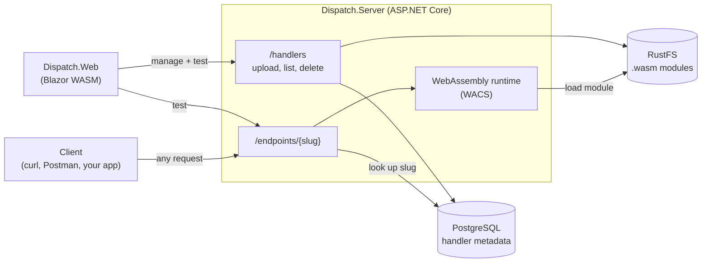

# dispatch
> **Programmable HTTP endpoints, written in WebAssembly**  
> Upload a WebAssembly component and dispatch serves it as an HTTP endpoint.

---

## What is dispatch?

dispatch hosts HTTP handlers compiled to [WebAssembly components](https://component-model.bytecodealliance.org/).
Upload a `.wasm` module and dispatch assigns it a slug. Requests to `/endpoints/{slug}` are passed to the module, and its return value is sent back as the HTTP response.

It started as an experiment for sandboxed, user-supplied bots in [karata](https://github.com/peter-mghendi/karata).
In its current state it can act as a programmable mock server, for example to:

- return `200 OK` to every request while the real API is being built.
- return a specific response when a request has a given header.
- echo requests back to inspect what a client or webhook sends.
- return a fixed payload while prototyping against a third-party API.

Handlers can be written in any language that compiles to a WebAssembly component.

---

## Status

dispatch is experimental. Handlers can be uploaded, invoked, and tested from the web UI.

- [x] Handler upload, listing, and deletion
- [x] Request/response invocation through a WIT contract
- [x] Sandboxed execution
- [x] Web UI with a built-in request tester
- [x] Copyable endpoint URLs

---

## How it works



1. **Upload.** Handler details are saved to PostgreSQL and the module to S3-compatible object storage.
2. **Invoke.** A request to `/endpoints/{slug}` runs the handler's module in a new [WACS](https://github.com/kelnishi/WACS) instance, with the request as input.
3. **Respond.** The module's `response` record is written back as the HTTP status, headers, and body.

Deleted handlers return `404` and are purged after a week.

---

## How to run this

### .NET Aspire

> [!NOTE]
> This method requires both the [.NET 10 SDK](https://get.dot.net/10) and the [.NET Aspire CLI](https://aspire.dev).
>
> PostgreSQL (TimescaleDB) and RustFS are provisioned automatically as Docker containers by Aspire, so no separate installation is required.

```shell
git clone https://github.com/peter-mghendi/dispatch.git
cd dispatch

aspire run
# OR
dotnet run --project Dispatch.AppHost/Dispatch.AppHost.csproj
```

This starts the following services:
- A [PostgreSQL](https://www.postgresql.org/) database ([TimescaleDB](https://www.timescale.com/) image).
- A [RustFS](https://rustfs.com/) server, for S3-compatible object storage.
- Dispatch.Server
- Dispatch.Web, served by the Aspire Blazor gateway at `/web/`.

> [!IMPORTANT]
> The AppHost needs credentials for the database. The Aspire dashboard will prompt you for them, or you can set them before the first run:
>
> ```shell
> dotnet user-secrets set "Parameters:postgres-username" "dispatch" --project Dispatch.AppHost
> dotnet user-secrets set "Parameters:postgres-password" "<a strong password>" --project Dispatch.AppHost
> ```
>
> The database keeps its data in a persistent volume, so use the same credentials between runs.

### Try it

Download the sample [echo](https://github.com/peter-mghendi/echo) module:

```shell
curl -LO https://github.com/peter-mghendi/echo/releases/latest/download/echo.wasm
```

Open the web app from the Aspire dashboard, click **Create Handler**, and upload `echo.wasm`.
The handler page shows the endpoint URL and a form for sending test requests.
See [API](#api) to do the same with curl.

---

## Writing a handler

A handler is a WebAssembly component that exports the `dispatch:guest/handler` interface:

```wit
package dispatch:guest@2.0.0;

interface handler {
  record request {
    method: string,
    path: string,
    headers: list<tuple<string, string>>,
    body: list<u8>,
  }

  record response {
    status: s32,
    headers: list<tuple<string, string>>,
    body: list<u8>,
  }

  handle: func(req: request) -> response;
}

world dispatch {
  export handler;
}
```

The contract lives in [`Dispatch.Guest/dispatch.wit`](Dispatch.Guest/dispatch.wit).
[echo](https://github.com/peter-mghendi/echo) is a complete example written in Go and built with [componentize-go](https://github.com/bytecodealliance/componentize-go).
To write your own handler, fork it and edit `export_dispatch_guest_handler/echo.go`.

Limits and errors:

- Modules must be 5 MB or smaller.
- `status` must be between `100` and `599`. Any other value returns a `502`.
- A trap or crash returns a `500`, and a handler that runs for more than 60 seconds returns a `504`.
- `path` is relative to the handler and always starts with `/`.

> [!NOTE]
> Handlers run in a sandbox with no access to environment variables, the filesystem, standard input/output, or sockets.
> Each request runs in a new instance, so no state is kept between requests.

---

## API

The examples below use the server's local address, `https://localhost:10001`.
[`Dispatch.Server/Dispatch.Server.http`](Dispatch.Server/Dispatch.Server.http) has the same requests for the JetBrains HTTP Client.

| Method | Route | Description |
| --- | --- | --- |
| `POST` | `/handlers` | Upload a handler (multipart: `file`, `title`, `description`, and an optional `slug`). |
| `GET` | `/handlers` | List handlers, newest first. |
| `GET` | `/handlers/{id}` | Get a handler, including its endpoint URL. |
| `DELETE` | `/handlers/{id}` | Delete a handler. |
| `GET` `POST` `PUT` `PATCH` `DELETE` `QUERY` | `/endpoints/{slug}/{path?}` | Invoke a handler. |

Slugs are 1-63 characters of `a-z`, `0-9`, and `-`, and can't start with `-`. If no slug is given, a random one is generated.

Upload a handler:

```shell
curl -X POST https://localhost:10001/handlers \
  -F "file=@echo.wasm;type=application/wasm" \
  -F "title=echo" \
  -F "description=Echoes requests back" \
  -F "slug=echo"
```

List handlers:

```shell
curl https://localhost:10001/handlers
```

Get a handler:

```shell
curl https://localhost:10001/handlers/{id}
```

Delete a handler:

```shell
curl -X DELETE https://localhost:10001/handlers/{id}
```

Invoke a handler:

```shell
curl -X POST https://localhost:10001/endpoints/echo \
  -H "Content-Type: text/plain" \
  -d "hello"
# hello
```

---

## Known issues

- **Requests are slow.** WebAssembly modules are validated before each run, so each request takes a few seconds before the handler runs, and longer for larger modules.
- **Only one path segment** after the slug is routed. `/endpoints/echo/a` works, but `/endpoints/echo/a/b` does not yet.
- **Other toolchains are untested.** Components built with `wit-component`, such as those built with [componentize-go](https://github.com/bytecodealliance/componentize-go), are tested. Components from other toolchains may not load yet.

---

## Project structure

```
Dispatch.AppHost/          Aspire AppHost: PostgreSQL, RustFS, server, web app + gateway
Dispatch.Server/           ASP.NET Core API and WebAssembly runtime
Dispatch.Web/              Blazor WebAssembly UI (MudBlazor)
Dispatch.Kit/              Typed HTTP client and shared models
Dispatch.Guest/            The WIT contract and its generated .NET harness
Dispatch.ServiceDefaults/  OpenTelemetry, service discovery, and resilience defaults
```
